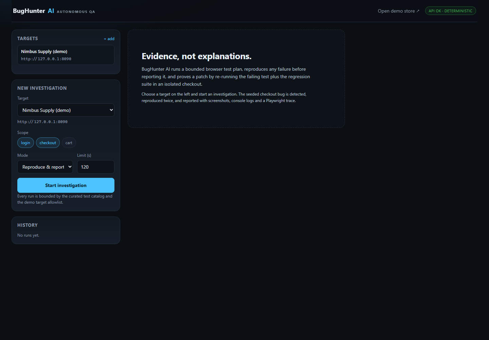
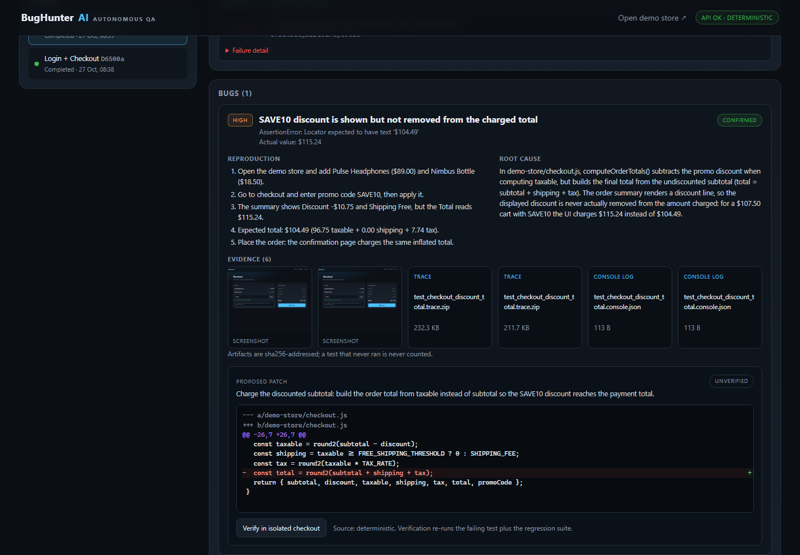
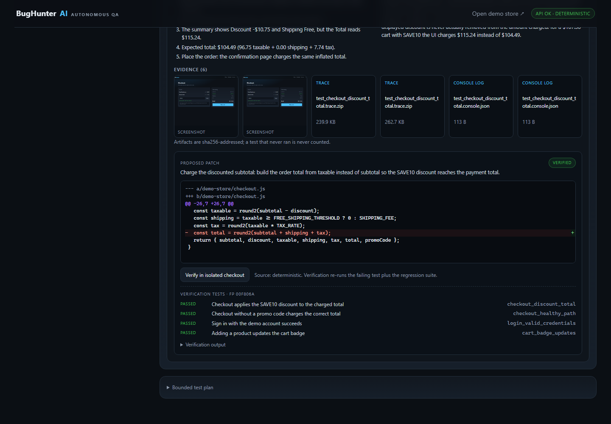
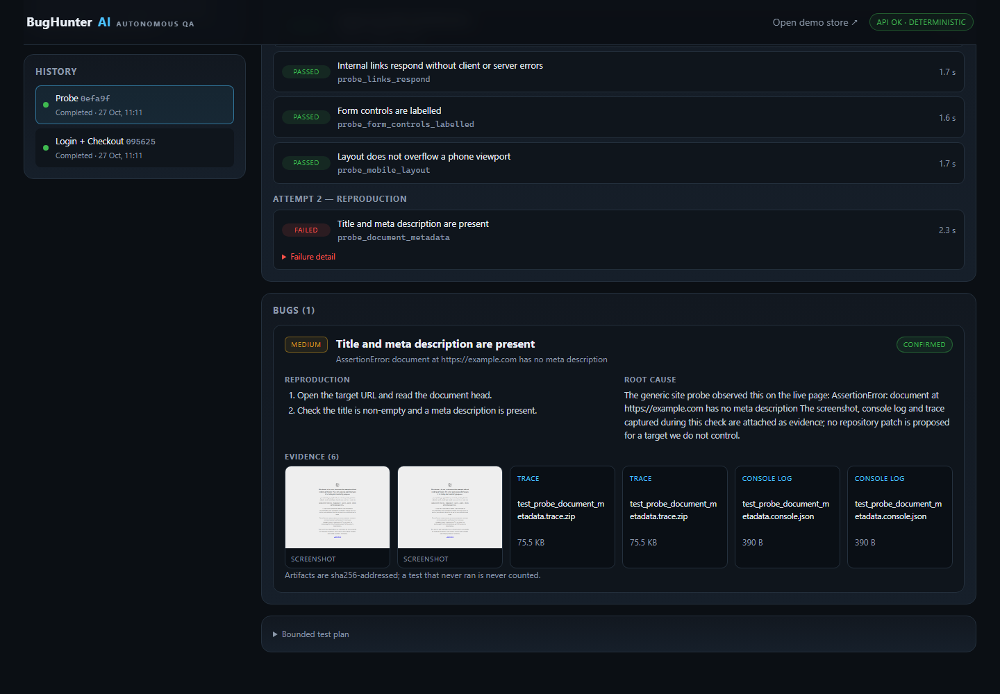
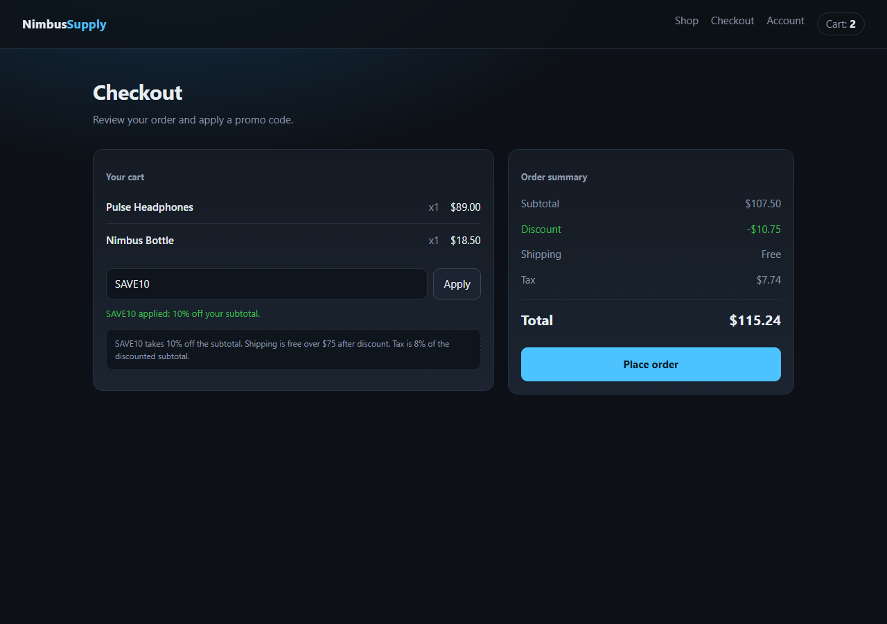
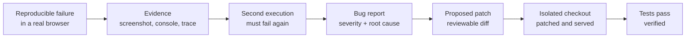
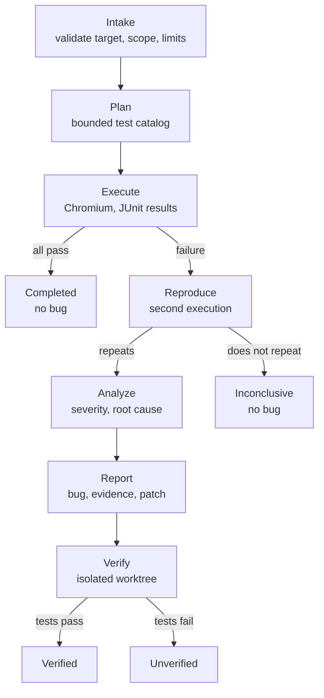
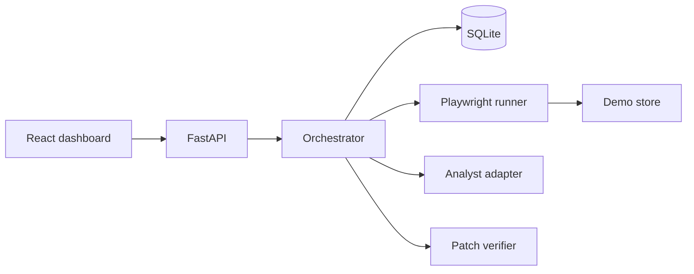
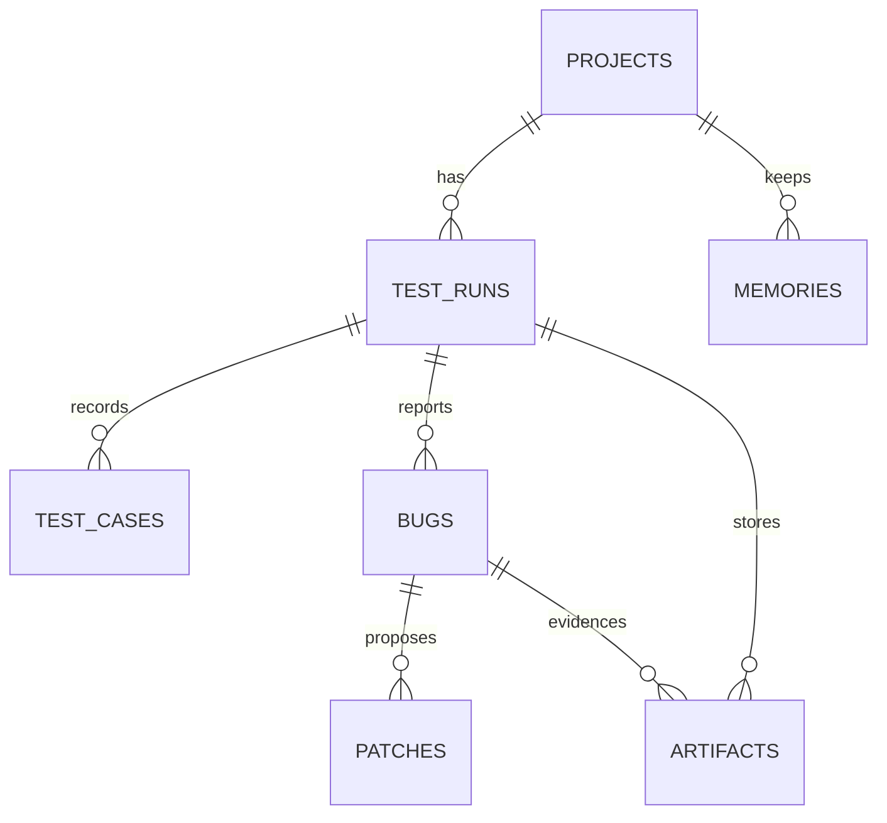

# BugHunter AI

**The autonomous QA engineer that proves its work.**

[](https://www.python.org/)
[](https://fastapi.tiangolo.com/)
[](https://react.dev/)
[](https://www.typescriptlang.org/)
[](https://playwright.dev/)
[](https://www.sqlite.org/)
[](LICENSE)
[](#roadmap)

Give it a URL and a scope. It plans a bounded browser test run, captures evidence, reproduces every
failure before reporting it, proposes a patch, and proves the patch by re-running the failing test
plus the regression suite in an isolated checkout.

> **An AI explanation is not evidence.**
> A bug is reported only when a test reproduces it twice.
> A fix is verified only when the relevant tests actually pass.
> A test that never ran is never counted as a pass.

Built for the **OpenFire Hackathon**. The bundled target, *Nimbus Supply*, contains one deliberately
seeded checkout bug and healthy paths that must stay green.

---

## Table of contents

1. [Screenshots](#screenshots)
2. [Why this exists](#why-this-exists)
3. [Features](#features)
4. [How it works](#how-it-works)
5. [The seeded bug](#the-seeded-bug)
6. [Quickstart](#quickstart)
7. [Using the dashboard](#using-the-dashboard)
8. [Test any URL](#test-any-url)
9. [API reference](#api-reference)
10. [Configuration](#configuration)
11. [Testing](#testing)
12. [Architecture](#architecture)
13. [Data model](#data-model)
14. [Security model](#security-model)
15. [Limitations](#limitations)
16. [Roadmap](#roadmap)
17. [Repository topics and labels](#repository-topics-and-labels)
18. [Contributing](#contributing)
19. [License](#license)
20. [References](#references)

---

## Screenshots

| Dashboard | Bug report with evidence |
| --- | --- |
|  |  |

| Patch verified by real tests | Probe run against a public site |
| --- | --- |
|  |  |



---

## Why this exists

Most AI QA tools stop at a plausible explanation. That is not a bug report, it is a guess.
BugHunter AI is built around a verifiable chain:



Every link in that chain is enforced in code, not in prose.

- A failure without evidence is not reported.
- A failure that does not repeat is `inconclusive`, not a bug.
- A target that is down is an infrastructure error, not an application bug.
- A patch that does not pass tests stays `unverified`.
- A verification request against a site this repository does not own is refused.

---

## Features

Priority follows the hackathon blueprint: P0 must work, P1 differentiates, P2 only if time remains.

| Priority | Feature | Status | Where |
| --- | --- | --- | --- |
| **P0** | Task submission with scope, mode and time limit | Done | `POST /api/runs`, dashboard |
| **P0** | Controlled demo target with a seeded bug | Done | `demo-store/` |
| **P0** | Real browser execution | Done | Playwright + Chromium |
| **P0** | Evidence capture | Done | screenshots, console logs, traces, pytest output |
| **P0** | Reproduction before reporting | Done | second execution gate |
| **P0** | Structured bug report | Done | severity, root cause, steps, evidence |
| **P0** | Results dashboard | Done | React + Vite at `/app/` |
| **P1** | Regression tests | Done | 4 browser journeys |
| **P1** | Suggested patch | Done | rule-based fix generator, unified diff |
| **P1** | Isolated patch application | Done | system-temp git worktree |
| **P1** | Verification | Done | failing test + regression suite must pass |
| **P1** | Investigation history | Done | SQLite, survives restarts |
| **P1** | Generic site probe for any public URL | Done | 8 target-agnostic checks |
| **P2** | GitHub issue/PR creation | Not built | — |
| **P2** | CI integration | Not built | — |
| **P2** | Scheduled runs | Not built | — |
| **P2** | Multi-project parallel agents | Not built | — |

Supporting engineering: typed API contracts (Pydantic), run state machine, target policy, sha256
artifact hashing, per-test verification history, deterministic analyst that works offline.

---

## How it works



Run states: `queued → planning → running → reproducing → analyzing → completed`, plus
`inconclusive`, `failed`, `timed_out`, `cancelled`. Invalid transitions are rejected.

### Test packs

| Pack | Scope key | File | Applies to |
| --- | --- | --- | --- |
| Demo journeys | `login`, `checkout`, `cart` | `tests/e2e/test_store.py` | the bundled Nimbus Supply target |
| Generic site probe | `probe` | `tests/e2e/test_site_probe.py` | any registered public URL |

External targets are limited to the probe pack: the API rejects demo scopes, the revision becomes
`external:<host>`, no patch is proposed, and verification is refused.

### Evidence chain

1. pytest drives Chromium; each test writes a full-page screenshot, console log and Playwright trace.
2. JUnit XML maps cases to catalog keys; missing cases are marked `not_run`, never `passed`.
3. Test rows and artifacts (with sha256) are persisted per attempt.
4. Only failures that fail in **both** attempts create bugs; both attempts' evidence is attached.
5. The patch applies to a disposable checkout, and verification is recorded per test.

---

## The seeded bug

`demo-store/checkout.js` computes the order total from the undiscounted subtotal:

```js
const taxable = round2(subtotal - discount);
// ...
const total = round2(subtotal + shipping + tax); // the discount never reaches the charge
```

| Step | Value |
| --- | --- |
| Cart | Pulse Headphones $89.00 + Nimbus Bottle $18.50 |
| Subtotal | **$107.50** |
| `SAVE10` | **-$10.75** |
| Taxable | **$96.75** |
| Shipping | free above $75 after discount |
| Tax (8%) | **$7.74** |
| Correct charge | **$104.49** |
| Buggy charge | **$115.24** |

The healthy no-promo path still passes, so a fix cannot be faked by breaking checkout entirely. The
proposed patch is generated from the file on disk, not hardcoded with line numbers, and applies to
a fresh checkout of the tested revision.

---

## Quickstart

### Requirements

- Python 3.11+ (3.12 tested)
- Node.js 18+ (20 and 24 tested)
- Git (patch verification prefers a worktree; a copy fallback exists)
- ~400 MB free for the Chromium download

### One command (Windows)

```powershell
.\scripts\run.ps1
```

Creates the virtual environment, installs dependencies, installs Chromium, builds the dashboard if
needed, and starts the API.

### Step by step (all platforms)

```powershell
python -m venv .venv
.\.venv\Scripts\Activate.ps1        # macOS/Linux: source .venv/bin/activate
pip install -r backend/requirements.txt
python -m playwright install chromium

cd frontend
npm install
npm run build
cd ..

python -m uvicorn backend.app.main:app --port 8000
```

| Surface | URL |
| --- | --- |
| Dashboard | <http://127.0.0.1:8000/app/> |
| API docs (Swagger) | <http://127.0.0.1:8000/docs> |
| Demo store | <http://127.0.0.1:8090> (starts on first run) |

The demo store is started lazily by the orchestrator, so a fresh install has no second service to
manage.

### Frontend development

```powershell
python -m uvicorn backend.app.main:app --port 8000 --reload
cd frontend
npm run dev      # http://localhost:5173, proxies /api to :8000
```

---

## Using the dashboard

1. **Targets** — the seeded demo store is registered automatically. Use `+ add` to register any
   public URL.
2. **New investigation** — choose a target, scope, mode and time limit.
3. **History** — every run is kept; select one to replay its report.
4. **Test outcomes** — attempt 1 (initial execution) and attempt 2 (reproduction), with durations
   and failure detail.
5. **Bug report** — severity, root cause, reproduction steps, screenshot, console log, trace.
6. **Proposed patch** — unified diff, then **Verify in isolated checkout**. The per-test verification
   rows persist, so a reload still shows what passed.

The 90-second recording script, exact numbers and fallback evidence are in
[`docs/demo-walkthrough.md`](docs/demo-walkthrough.md).

---

## Test any URL

Register a public target and run scope `probe`:

```powershell
$body = '{"name":"Example","base_url":"https://example.com"}'
$project = Invoke-RestMethod -Method Post -Uri http://127.0.0.1:8000/api/projects `
  -ContentType application/json -Body $body

$run = Invoke-RestMethod -Method Post -Uri http://127.0.0.1:8000/api/runs `
  -ContentType application/json -Body "{`"project_id`":`"$($project.id)`",`"scope`":[`"probe`"]}"
```

| Check | Severity on failure |
| --- | --- |
| Page loads below HTTP 400 | critical |
| No uncaught console or page errors | high |
| No 4xx or 5xx subresource or API responses | high |
| Title and meta description present | medium |
| Images resolve with real dimensions | medium |
| Up to 10 internal links respond | medium |
| Form controls have accessible names | low |
| No horizontal overflow at a 390px viewport | low |

A failing check reproduces a second time, then becomes a bug with the captured evidence. No patch
is proposed for a site this repository does not own.

Policy: public `http/https` URLs are allowed; private, loopback (other than the demo store),
link-local, reserved and cloud-metadata addresses are rejected before execution.

---

## API reference

| Method | Endpoint | Purpose |
| --- | --- | --- |
| `GET` | `/api/health` | Service health, provider, demo target status |
| `GET` | `/api/catalog` | Curated tests and scopes |
| `POST` | `/api/projects` | Register a target |
| `GET` | `/api/projects` | List targets |
| `GET` | `/api/projects/{id}/memories` | Investigation memory for a project |
| `POST` | `/api/runs` | Start a bounded run (`202`) |
| `GET` | `/api/runs` | Run history |
| `GET` | `/api/runs/{id}` | Status and summary |
| `GET` | `/api/runs/{id}/live` | Compact polling payload |
| `GET` | `/api/runs/{id}/tests` | Test outcomes per attempt |
| `GET` | `/api/runs/{id}/bugs` | Confirmed bugs with evidence and patches |
| `GET` | `/api/runs/{id}/artifacts` | Artifact metadata |
| `GET` | `/api/bugs/{id}` | One bug |
| `POST` | `/api/bugs/{id}/patches` | Save a manually authored patch |
| `GET` | `/api/patches/{id}` | Proposed patch and verification state |
| `POST` | `/api/patches/{id}/verify` | Verify in an isolated checkout |
| `GET` | `/api/artifacts/{id}` | Download an authorized artifact |

Start a run:

```json
{
  "project_id": "…",
  "scope": ["login", "checkout"],
  "mode": "reproduce",
  "max_duration_seconds": 120
}
```

Run status payload:

```json
{
  "status": "completed",
  "summary": {
    "tests_total": 3,
    "passed": 2,
    "failed": 1,
    "confirmed_bugs": 1,
    "patch_ids": ["…"],
    "duration_ms": 28000,
    "provider": "deterministic"
  }
}
```

`scope` accepts `probe`, `login`, `checkout`, `cart`. `mode` accepts `reproduce` and `fix`.
Requests are validated before execution and rejected with `400` when the target or scope is
disallowed.

---

## Configuration

Copy `.env.example` and export the variables, or use your process manager.

| Variable | Default | Meaning |
| --- | --- | --- |
| `BUGHUNTER_DB` | `data/bughunter.db` | SQLite database path |
| `BUGHUNTER_ARTIFACT_DIR` | `data/artifacts` | Evidence storage |
| `BUGHUNTER_DEMO_DIR` | `demo-store` | Demo target directory |
| `BUGHUNTER_DEMO_PORT` | `8090` | Demo target port |
| `BUGHUNTER_ALLOWED_PORTS` | empty | Optional loopback port allowlist |
| `BUGHUNTER_ALLOW_EXTERNAL_TARGETS` | `1` | Accept public URLs |
| `BUGHUNTER_ALLOWED_HOSTS` | empty | Optional host allowlist |
| `BUGHUNTER_ALLOW_PRIVATE_TARGETS` | `0` | Allow private/internal targets (dangerous) |
| `BUGHUNTER_REQUIRE_DEMO_TARGET` | `1` | Require the demo identity header |
| `BUGHUNTER_RUN_TIMEOUT` | `120` | Default seconds per browser attempt |
| `BUGHUNTER_MAX_RUN_TIMEOUT` | `600` | Hard cap for requested timeouts |
| `BUGHUNTER_AI_BASE_URL` | empty | OpenAI-compatible endpoint |
| `BUGHUNTER_AI_API_KEY` | empty | Bearer token, never logged |
| `BUGHUNTER_AI_MODEL` | empty | Model identifier |

With no AI variables set, the deterministic analyst runs everything offline. With an endpoint
configured, explanations may come from the model, but plans stay clamped to the catalog, patches
still pass path validation, and verification is still performed by tests.

---

## Testing

```powershell
# Backend contract tests, including the full reproduce → patch → verified loop
python -m pytest backend/tests -q

# Browser suite against the broken demo store:
# 12 tests, 1 intentional failure (the seeded bug)
python -m pytest tests/e2e -q

# Frontend type check and production build
cd frontend; npm run build
```

Expected: `9 passed` for the backend suite and `11 passed, 1 failed` for the browser suite. The
single failure is `test_checkout_discount_total`, which is the fixture. The generic probe pack
passes against the demo store, and is exercised standalone against any URL.

Tests cover: target policy, unsafe scopes, the probe pack, the run state machine, patch path
validation, a suite that never ran (must fail as `runner_error`), reproduction, evidence hashing,
patch verification and persistence across reloads.

---

## Architecture

A modular monolith: one FastAPI process, one SQLite file, one React bundle, one Playwright runner.



| Layer | Technology | Responsibility |
| --- | --- | --- |
| Dashboard | React 18, TypeScript, Vite | Targets, runs, evidence, patch verification |
| API | FastAPI, Pydantic v2 | Contracts, validation, authorization |
| Orchestrator | Python threads | State machine, reproduction gate, persistence |
| Runner | Playwright, pytest, JUnit | Browser execution and evidence |
| Analyst | Deterministic rules, optional LLM | Plan, root cause, severity |
| Storage | SQLite (WAL, foreign keys) | Durable audit trail |

```text
bughunter-ai/
├── backend/
│   ├── app/
│   │   ├── ai/provider.py        # planner and analyst adapters
│   │   ├── runner/               # pytest + JUnit wrapper
│   │   ├── catalog.py            # curated tests and demo knowledge
│   │   ├── orchestrator.py       # run lifecycle and patch verifier
│   │   ├── security.py           # target policy and patch validation
│   │   ├── main.py               # FastAPI routes
│   │   └── db.py, repository.py  # schema and persistence
│   ├── tests/                    # API contract tests
│   └── requirements.txt
├── demo-store/                   # Nimbus Supply storefront (seeded bug)
├── frontend/                     # React dashboard
├── tests/e2e/                    # demo journeys and generic probe pack
├── docs/                         # architecture, setup, security, demo script
├── integrations/alan/            # Alan integration notes
├── scripts/                      # launcher and GitHub setup
└── data/                         # runtime state (gitignored)
```

More detail: [`docs/architecture.md`](docs/architecture.md).

---

## Data model



| Table | Purpose |
| --- | --- |
| `projects` | Registered targets |
| `test_runs` | Lifecycle, scope, plan, summary, tested revision |
| `test_cases` | Per-attempt outcomes with durations and failure text |
| `bugs` | Severity, root cause, reproduction steps |
| `artifacts` | Evidence metadata, storage path, sha256 |
| `patches` | Diff, verification status, per-test verification rows |
| `memories` | Reusable investigation summaries |

---

## Security model

| Risk | Control |
| --- | --- |
| Testing internal infrastructure | Public http/https only; private, loopback, link-local, reserved and metadata addresses rejected after DNS resolution |
| Testing an unrelated local service | `X-Demo-Target: nimbus-supply` handshake for the demo target |
| Unbounded execution | Curated catalog, per-run timeout, hard cap |
| Patch escaping the workspace | Path validation rejects absolute paths, `..`, `.git`, `.env`, `.pem`, `secrets`, and anything outside allowed roots |
| Editing the real tree | Patches apply in a system-temp worktree; fallback is a full copy |
| Credentials in logs or prompts | The adapter receives test names and assertion text only |
| False evidence | Browser-produced artifacts, sha256 hashes, tested revision recorded |
| Fake fixes | Only the verifier can mark a patch `verified`, and only after tests pass |

Operational guidance and residual risks are documented in [`docs/security.md`](docs/security.md).
The API has no authentication and no rate limiting: keep it on localhost or behind an authenticated
proxy.

---

## Limitations

- The generic pack is a smoke/quality probe, not a functional suite: it cannot log in, fill forms or
  assert business rules on a site it has never seen.
- Patch proposals and verification exist only for the bundled demo checkout.
- One run executes at a time per request; runs are not queued or parallelised.
- The deterministic analyst knows the seeded bug precisely. This is disclosed in the UI as
  `rule-based`; other failures are reported with evidence but without an invented root cause.
- Alan cloud integration is not claimed as verified; see
  [`integrations/alan/README.md`](integrations/alan/README.md).
- Docker packaging was deliberately skipped to protect demo time.

---

## Roadmap

| Next | Notes |
| --- | --- |
| AI-authored test plans from the DOM | Model proposes steps, catalog still bounds what runs |
| GitHub issue / PR creation | Would require explicit human approval before any write |
| CI integration | Run the probe pack on every deploy preview |
| Queue and parallel workers | Move from one orchestrator thread to a bounded worker pool |
| Docker packaging | Repeatable browser environment for graders |
| Deeper functional checks | Auth flows, forms, and per-site assertions |

---

## Repository topics and labels

Suggested GitHub **topics**:

```text
ai-testing  autonomous-agents  qa-automation  browser-testing  playwright
fastapi  react  typescript  sqlite  bug-reproduction  patch-verification
hackathon  openfire  software-testing  test-automation  llm
```

Suggested **labels** (create them with `scripts/github-setup.ps1`):

| Label | Colour | Use for |
| --- | --- | --- |
| `bug` | `d73a4a` | Confirmed defects |
| `enhancement` | `a2eeef` | New capability |
| `documentation` | `0075ca` | README and docs |
| `security` | `b60205` | Target policy, isolation, secrets |
| `testing` | `1d76db` | Runner, suites, evidence |
| `p0` / `p1` / `p2` | `5319e7` / `0e8a16` / `fbca04` | Hackathon priority |
| `good first issue` | `7057ff` | Small, well-scoped work |
| `hackathon` | `ff8c00` | Event-related work |

A version tag `v0.1.0` is created locally during preparation. See
[`docs/github-setup.md`](docs/github-setup.md) for the push, topic, label and release commands.

---

## Contributing

Read [`CONTRIBUTING.md`](CONTRIBUTING.md). The invariants are not negotiable: reproduce before
reporting, prove before verifying, never count a test that did not run.

---

## License

MIT — see [`LICENSE`](LICENSE).

---

## References

- OpenFire event listing: <https://luma.com/2k6cxr0n>
- Alan: <https://alan.ai/>
- Alan AI GitHub organization: <https://github.com/alan-ai>
- Playwright: <https://playwright.dev/>
- FastAPI: <https://fastapi.tiangolo.com/>

Built with an Alan software-engineering session; the product does not depend on Alan at runtime.
