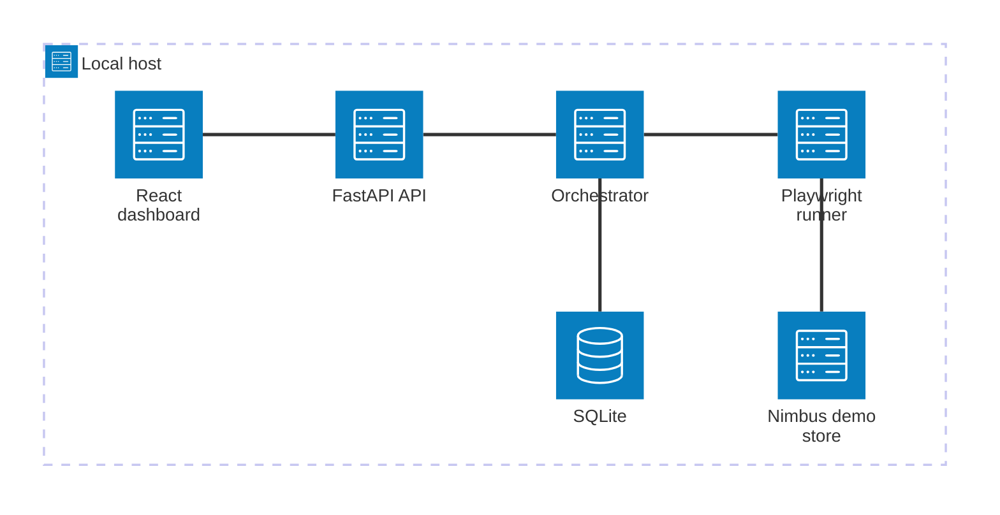
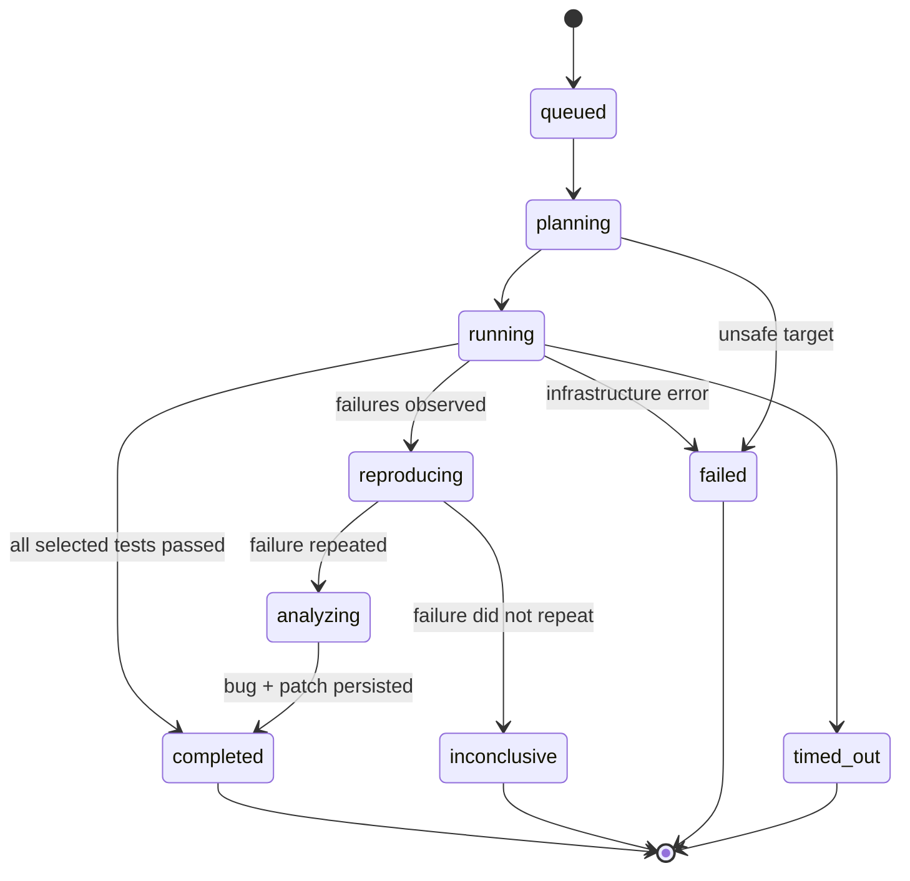
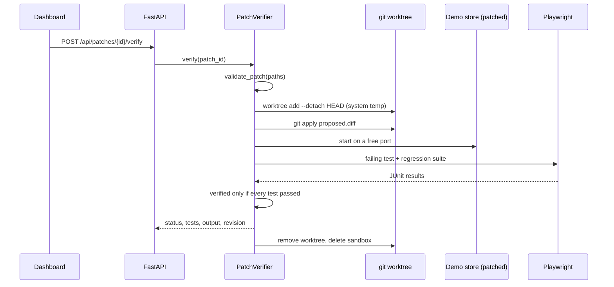
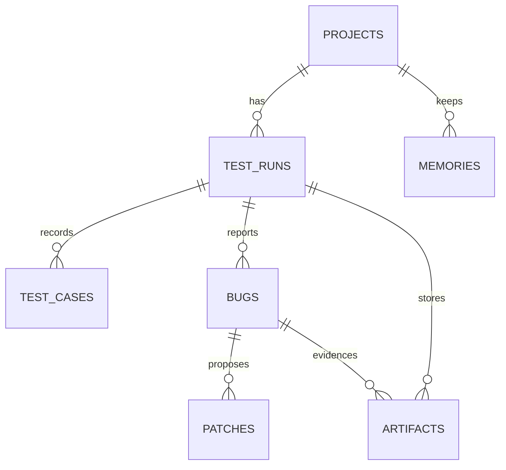

# Architecture

## Shape

A modular monolith: one FastAPI process, one SQLite file, one React bundle, one Playwright runner.

| Layer | Technology | Responsibility |
| --- | --- | --- |
| Dashboard | React 18 + TypeScript + Vite | Projects, run start, live status, tests, bugs, evidence, patch verification |
| API | FastAPI 0.115 | Contracts, validation, orchestration entrypoints, artifact authorization |
| Orchestrator | Python threads | State machine, reproduction gate, bug/patch persistence |
| Runner | Playwright (Chromium) via pytest | Real browser execution, JUnit results, screenshots, console, traces |
| Analyst | Deterministic rules; optional OpenAI-compatible adapter | Plan, root cause, severity, suggested patch |
| Store | SQLite (WAL, foreign keys) | Projects, runs, tests, bugs, artifacts, patches, memories |
| Demo target | Static storefront + stdlib server | Deterministic seeded failure and healthy paths |

## Test packs

| Pack | Scope key | File | Applies to |
| --- | --- | --- | --- |
| Demo journeys | `login`, `checkout`, `cart` | `tests/e2e/test_store.py` | the bundled Nimbus Supply target only |
| Generic site probe | `probe` | `tests/e2e/test_site_probe.py` | any registered public URL |

The runner groups selected tests by file and runs them in one pytest invocation, so a run can mix
packs. External targets are restricted to the probe pack: the API rejects demo scopes for them, the
tested revision becomes `external:<host>` instead of a git commit, no patch is proposed, and patch
verification refuses anything that is not the local demo checkout.

## Run lifecycle

Every transition is checked against `ALLOWED_TRANSITIONS`; anything else raises and is recorded as
an internal failure rather than silently mutating state.

## Evidence chain

1. The runner executes selected tests with `BASE_URL` and `EVIDENCE_DIR` set.
2. Each test writes a full-page screenshot, a console log with page errors, and a Playwright trace.
3. pytest writes JUnit XML; the runner maps case names to catalog keys and marks missing cases
   `not_run` — never `passed`.
4. The orchestrator records test cases per attempt and hashes every artifact with sha256.
5. A bug is created only for failures that failed in both attempts; attempt-1 and attempt-2
   artifacts are attached to it.
6. The bug carries severity, root cause, reproduction steps and the tested git revision.

## Patch verification

If the worktree cannot be created (no commit yet), the verifier copies the repo into a temp
directory instead. Both paths are isolated from the working tree.

## Data model

Key invariants enforced in code, not just documented:

- `patches.verification_status` becomes `verified` only inside `PatchVerifier._finish` after the
  suite passed.
- `test_cases.status = not_run` is excluded from pass counts.
- Infrastructure errors set `test_runs.error_kind = infrastructure` and create no bug.
- `artifacts.sha256` plus `test_runs.target_revision` make an investigation auditable.

## Why these choices

- **Playwright via pytest** instead of a Node test stack: one language for backend, runner and
  verification, one dependency tree, and JUnit output is trivial to consume.
- **Curated catalog** instead of free-form generation: a hackathon demo must be repeatable, and
  bounded scope is a safety property, not a limitation to hide.
- **Static demo store with vanilla JS**: no build step for the target, deterministic behaviour, and
  the seeded bug stays readable in a diff.
- **Git worktree** for isolation: the patch under test is applied to a real checkout, and the main
  working tree is never modified.
- **Deterministic analyst by default**: the demo works without API keys or network access, and the
  model stays an optional adapter behind the same interface.